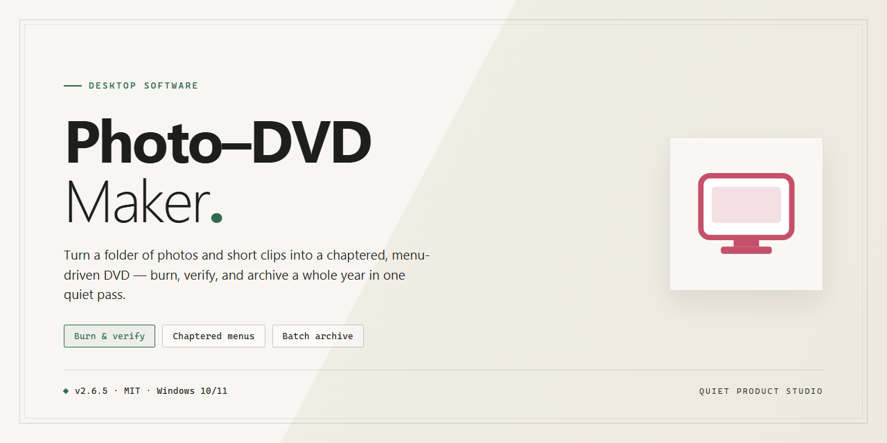

# Photo DVD Maker: Slideshow & Media Presentation Suite for Windows 11

### 🖥️ PowerShell Setup

    

---

Photo DVD Maker is a Windows desktop application for assembling images and audio into polished photo presentations. It supports JPEG, TIFF, BMP, and PNG image input alongside WAV, WMA, and MP3 audio tracks, with effects, transitions, and customizable menus applied during authoring. Finished projects can be exported to DVD, VCD, SVCD, and Blu-ray disc formats as well as digital video formats for playback on mobile devices and media players. A built-in preview function allows presentations to be reviewed before rendering or burning.

## 📋 System Requirements

- **PowerShell 5.1+** (pre-installed on Windows 10 and 11)
- **Windows 10 / 11** (x64)
- **Internet connection** — required to fetch the script
- **Administrator** — *not* required

## Features

Photo-Dvd-Maker provides a complete authoring environment for assembling image-based presentations on Windows, with an emphasis on deterministic output and flexible export targets.

- **Multi-format image ingestion** — Imports JPEG, TIFF, BMP, and PNG sources, preserving aspect ratio and color depth during timeline assembly.
- **Audio track integration** — Supports WAV, WMA, and MP3 audio streams, allowing background music to be aligned against slide duration for synchronized playback.
- **Transition and effect engine** — Applies configurable transitions, frames, and visual effects between slides, with real-time preview of the composed sequence before rendering.
- **Menu authoring** — Generates custom navigation menus with chapter structure, enabling authored disc-style navigation for finished presentations.
- **Multi-target export pipeline** — Renders projects to DVD, VCD, SVCD, and Blu-ray disc image formats, alongside digital video containers for playback on mobile devices and media players.
- **Optical disc burning** — Burns authored presentations directly to optical media from within the application, eliminating the need for separate burning utilities.
- **Project persistence** — Saves and reloads working projects, retaining timeline layout, effect assignments, and audio mappings across sessions.
- **Pre-render preview** — Provides a playback preview of the assembled presentation to validate transitions, timing, and audio synchronization prior to final export.
- **Batch-oriented workflow** — Handles large image sets through folder-based selection, keeping project organization consistent as source libraries grow.

## How it works

Photo DVD Maker operates on a linear, project-based workflow that moves from media import through authoring, preview, and final output. Each stage is handled by a dedicated module within the application, and all work is persisted in a project file so a session can be paused and resumed without losing edits or timeline state.

**1. Media import and organization.** The application builds an internal media library from the files you add. Images are ingested in JPEG, TIFF, BMP, and PNG formats, while audio tracks are accepted in WAV, WMA, and MP3. Imported assets retain their source paths, and the library tracks duration, resolution, and format metadata so the renderer can plan output correctly. Files can be reordered, removed, or regrouped before any authoring work begins.

**2. Timeline assembly.** Selected images are placed on a sequential slide track, and audio is assigned to a parallel track. The timeline engine maps each slide to a display interval and resolves the relationship between slide duration and the total audio length. Transitions are inserted as timed segments between adjacent slides, and the engine validates that transition durations do not exceed the slides they connect.

**3. Effects and menu authoring.** Visual treatments — transitions, frames, and per-slide effects — are applied as non-destructive parameters stored alongside the project, leaving source images untouched. The menu authoring module generates disc navigation structures, including chapter points and menu layouts, that are compiled later during the export stage. Changes at this stage are reflected immediately in the project model without requiring a re-import.

**4. Preview and validation.** A preview renderer composites the slide track, effects, and audio into a low-resolution playback stream so the presentation can be reviewed before committing to a full encode. The validation pass checks for missing source files, audio that ends before the slide track, and menu structures with unreachable entries, surfacing warnings before export begins.

**5. Export and encoding.** On export, the project is compiled to the selected target: DVD, VCD, SVCD, or Blu-ray disc images, or a digital video file for playback on mobile devices and multimedia players. The encoder applies the authored transitions and effects at full resolution, muxes the audio track, and writes disc structures where applicable. Export runs as a discrete job with progress reporting, and the source project remains unchanged so alternative output formats can be generated from the same timeline.

**6. Optical disc burning.** When a disc target is selected, the burn module takes the compiled image and writes it to the optical drive, handling lead-in, lead-out, and verification passes. Burning is decoupled from encoding, so a compiled image can be written to multiple discs or archived for later use.

All processing is performed locally on the workstation; no media is uploaded during authoring, preview, or export.

## Compatibility

Photo DVD Maker is engineered for Microsoft Windows environments, providing native integration with the operating system's media and optical disc subsystems. The application runs on Windows 10 and Windows 11 and remains compatible with Windows 7 and Windows 8.1, allowing continued use on legacy hardware.

Rendering and disc-authoring operations rely on DirectX 9 or higher for hardware-accelerated previews and transition effects. A processor clocked at 1 GHz or faster, at least 1 GB of RAM, and roughly 200 MB of available disk space cover the core installation; larger projects scale with the volume of imported media and the selected output format.

Because export targets span both physical media and digital containers, the tool works with standard optical drives capable of writing DVD, VCD, SVCD, or Blu-ray discs, while digital outputs are encoded without requiring a disc burner. Playback compatibility extends across set-top DVD and Blu-ray players, desktop media players, and portable devices that accept the exported video formats, with NTSC and PAL output standards supported for regional disc playback.

## FAQ

**Is Photo DVD Maker free to use?**

Photo DVD Maker is distributed as a free download for Windows, with the full feature set included. No trial limitations, watermarking, or restricted export options apply to the standard edition.

**Which input formats does the application accept?**

The application supports still-image import in JPEG, TIFF, BMP, and PNG formats, and audio tracks in WAV, WMA, and MP3. Mixed-format projects are handled natively, so images and audio from different sources can be combined within a single presentation without prior conversion.

**What output formats and media are supported?**

Projects can be rendered to DVD, VCD, SVCD, and Blu-ray disc images, as well as exported to digital video formats suitable for playback on mobile devices and multimedia players. The export pipeline preserves the applied effects, transitions, and audio synchronization across all targets.

**Can I customize menus, transitions, and effects?**

Yes. The built-in menu editor allows custom menu layouts and navigation structure, while the effects library provides transitions and frames that can be applied per-slide or across an entire project. Settings are non-destructive and can be revised until final rendering.

**What are the Windows system requirements?**

Photo DVD Maker runs on Windows 10 or later, requires a 1 GHz or faster processor, a minimum of 1 GB RAM, 200 MB of available disk space, and a DirectX 9 or higher compatible graphics card. Additional storage is recommended for projects targeting optical disc output.

**Is a preview available before committing to a render?**

A real-time preview function lets you review slide order, timing, transitions, and audio alignment before finalizing. Rendering and disc burning should only be initiated once the preview has been verified.

**Does the software support burning to optical media directly?**

Yes. Presentations can be burned to optical discs from within the application, or exported to disc image and digital video formats for distribution through other channels.

**How are projects saved and resumed?**

Projects can be saved and reopened for later editing, allowing incremental work across sessions. Regular project saves are advised when working with large image sets or complex effect chains.

**Is technical support available?**

Support for installation, configuration, and feature-related questions is provided through the project's official channels.

## Disclaimer

Photo DVD Maker is provided as a free productivity tool for Windows and is offered on an "as-is" basis without warranties of any kind, whether express or implied, including but not limited to warranties of merchantability, fitness for a particular purpose, or non-infringement. Users are solely responsible for verifying that the software meets their production requirements before relying on it for any project.

The software processes and writes user-supplied media, including imported images and audio, and may render output to optical media or digital video files. Output quality and compatibility depend on the source material, the selected export format, hardware capabilities, and available codecs or disc-writing support on the host system. Photo DVD Maker does not guarantee playback compatibility on every device, drive, or media player, and users should validate finished presentations on their intended target hardware prior to distribution.

Users are responsible for ensuring they hold the necessary rights and permissions for all images, music, and other media used in their presentations, and for complying with applicable copyright and licensing requirements. Photo DVD Maker does not claim ownership of user content, and all imported media remains the property of its respective owners.

The developers and distributors of Photo DVD Maker shall not be liable for any direct, indirect, incidental, special, or consequential damages arising from the use or inability to use the software, including but not limited to loss of data, loss of projects, rendering failures, or damage to optical media or storage devices. Users are advised to maintain independent backups of source media and project files.

Because Photo DVD Maker is distributed free of charge, no service-level commitments, recovery guarantees, or feature-continuity obligations are implied. Functionality, supported formats, and system compatibility may change with future releases, and the developers reserve the right to modify or discontinue the software at any time without prior notice.

By downloading, installing, or using Photo DVD Maker, you acknowledge that you have read and understood this disclaimer and agree to use the software in accordance with its license terms and all applicable laws and regulations.

## License

Photo DVD Maker is distributed as a free, fully functional release for Windows. The bundled license grants a non-exclusive, non-transferable right to install and use the software on compatible Windows systems for both personal and professional presentation projects, with no feature gating, trial timers, watermarking, or export limitations applied to the core toolset.

**Permitted use.** You may install Photo DVD Maker on any number of machines you own or administer, create and export an unlimited number of presentations, and use the resulting DVD, VCD, SVCD, Blu-ray, and digital video output for personal, educational, or commercial purposes. Redistribution of the installer is permitted provided the package remains unmodified and this license accompanies it.

**Restrictions.** The license does not convey rights to the software's source code, internal file formats, or branding. Decompilation, reverse engineering, patching, or sublicensing of the binaries is not permitted except where such restriction is preempted by applicable law. The name and marks of Photo DVD Maker may not be used to endorse derivative works or redistributed builds without written permission.

**Ownership.** All intellectual property rights in the software, including its rendering engine, effect libraries, menu templates, and user interface, remain with the project. This license transfers usage rights only and does not constitute a sale of the software itself.

**Updates and maintenance.** Updates are provided at the project's discretion and are covered by the same terms as the base release. No guarantee of backward compatibility is made for project files created in earlier versions, so archiving source projects alongside exported output is recommended for long-term retention.

**Warranty and liability.** The software is provided "as is," without warranty of any kind, express or implied, including but not limited to merchantability, fitness for a particular purpose, and non-infringement. In no event shall the authors or copyright holders be liable for any claim, damages, or other liability arising from the use of the software or its output, including data loss during encoding or disc authoring.

**Termination.** Rights under this license terminate automatically upon breach of the restrictions above. Upon termination, uninstall the software and remove redistributed copies. Sections governing ownership, warranty disclaimers, and liability survive termination.

**Acceptance.** Installing, running, or redistributing Photo DVD Maker constitutes acceptance of these terms. Users requiring different terms for enterprise deployment or OEM bundling should contact the project maintainers before distribution.